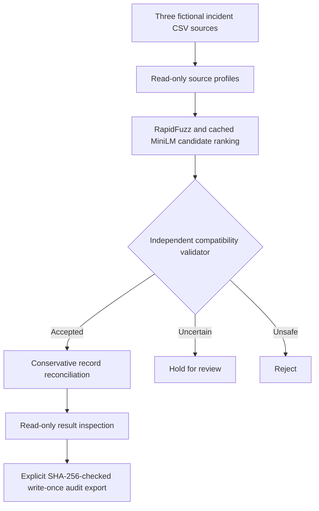
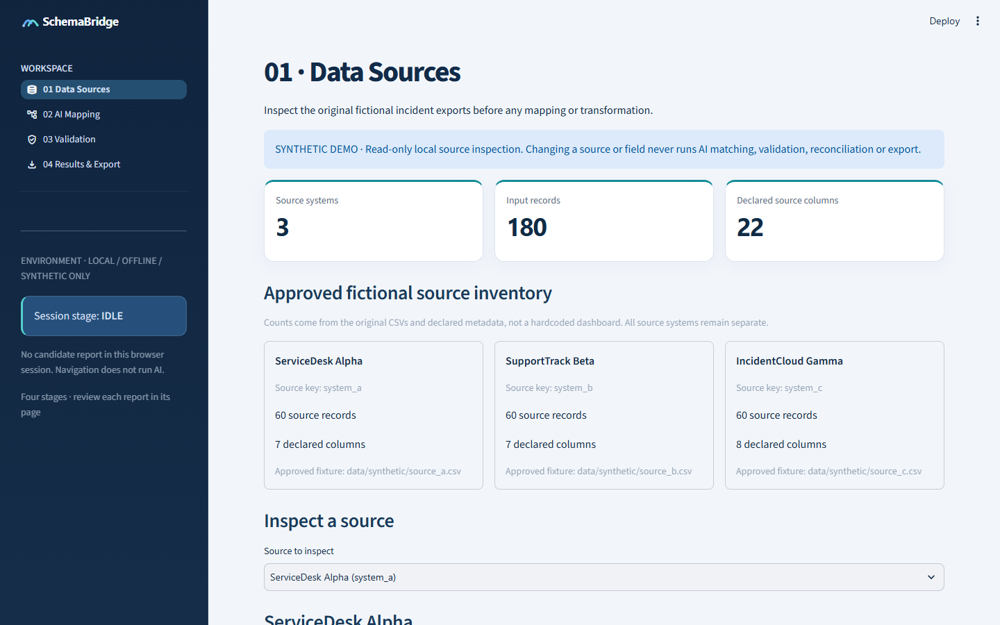
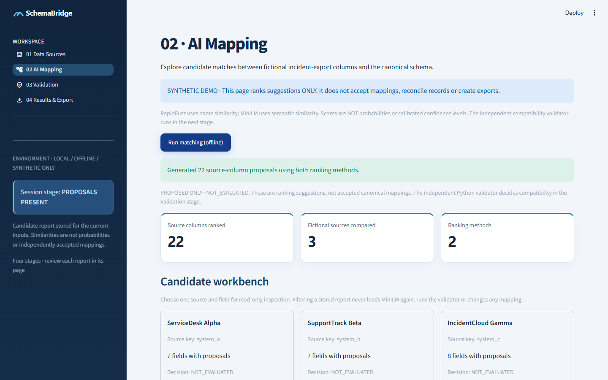
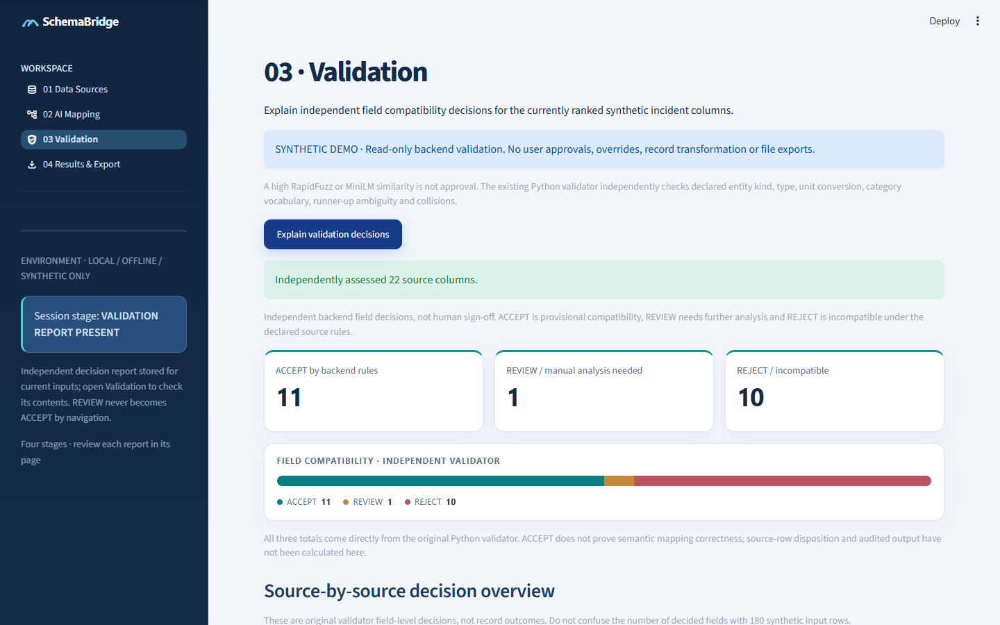
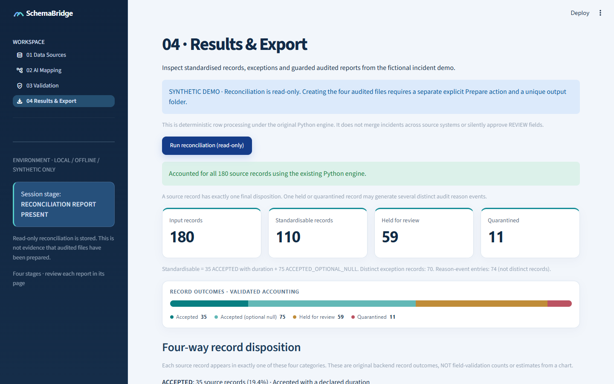

# SchemaBridge

**AI-assisted schema matching with explainable validation and auditable data reconciliation.**

SchemaBridge is a local Python + Streamlit portfolio project that explores a real data engineering problem: different systems describe the same business concepts using different names, types, categorical values and time units. Matching labels alone can be misleading, and high embedding similarity is **not** proof that two fields are safe to combine.

The application proposes matches with **RapidFuzz** and locally cached **MiniLM**, checks them using an **independent Python validator**, then conservatively standardises records while preserving source identity. The demo uses **three entirely fictional IT incident CSV sources**. It is not a production customer-data integration service.

## How it works



The ranking models only **propose**. A separate compatibility gate checks declared business meaning, entity kind, type, units, approved categories, ambiguity and collisions. It does not silently auto-approve a reviewer-held match. The system preserves leading-zero identifiers and source provenance; it **does not join incident records across source systems**.

The canonical business fields for this demonstration are `incident_id`, `region`, `incident_status` and `resolution_minutes`. Technical `source_system` and `source_record_id` columns are generated traceability, not AI-matched business fields.

## Interface screenshots

These are **genuine screenshots from the owner's local Windows/Chrome Streamlit demo**, using three fictional incident datasets and a locally cached MiniLM model. They are not product mockups, production data or evidence of a new public-clone CI run. The read-only capture did not prepare any audited output.

| Data Sources | AI Mapping |
|---|---|
|  |  |
| Validation | Results & Export |
|  |  |

The approved design places the existing SchemaBridge wordmark above four native navigation routes, with a dark navy sidebar and a light, data-focused workspace. The owner accepted this final four-page look after **22/22 focused Windows GUI tests** and complete real-browser capture on **1 November 2026**.

## The four-page workbench

| Page | Purpose |
|---|---|
| **01 Data Sources** | Preview the original fictional exports, their profiles and declared metadata |
| **02 AI Mapping** | Explicitly run offline lexical and semantic ranking; review candidates and raw similarities |
| **03 Validation** | Explain ACCEPT, REVIEW and REJECT decisions from the original independent validator |
| **04 Results & Export** | Inspect standardised, held and quarantined outcomes; separately prepare guarded four-file audited reports |

Reading pages or changing presentation filters never authorises model inference or output writes. Export files are generated only by an explicit original-backend action to a new ignored directory and verified against a session-bound manifest.

## Historical results on the approved synthetic demonstration

| Observed property | Result |
|---|---:|
| Source records | **180** in three fictional exports |
| Declared source columns | **22** |
| Standardisable records | **110** |
| Held for review | **59** |
| Quarantined | **11** |
| Distinct exception records | **70** |
| Exception reason events | **74** |
| Cross-source record joins | **0** |

These are **historical observed figures**, not guaranteed behaviour across arbitrary future data.

A separate, once-frozen **fictional challenge** contained nine truly equivalent source fields. The original conservative system auto-accepted only **3/9 (33.33% recall)**. The three auto-accepted cases were correct in this small sample (3/3), which does **not** demonstrate broad real-world precision. The synthetic answer keys were subsequently disclosed and are not a fresh hidden benchmark. The runtime `evaluation.json` is an **unscored placeholder**, not a measured validation report.

## Architecture and repository layout

| Path | Role |
|---|---|
| [`src/schemabridge/`](src/schemabridge/) | Ingestion, candidate ranking, profile, independent validation and reconciliation logic |
| [`gui/`](gui/) | Streamlit router, four presentation pages, session state and guarded backend adapter |
| [`config/`](config/) | Approved schema, source metadata and standardisation rules |
| [`data/synthetic/`](data/synthetic/) | Three fictional CSV source exports |
| [`design/brand/`](design/brand/) | Original SVG product mark |
| [`tests/`](tests/) and [`gui/tests/`](gui/tests/) | Selected regression examples; not a complete copy of all historical test suites |

The code is deliberately separated into proposals, deterministic validation, row reconciliation and presentation. No matching score is represented as a calibrated probability.

## Running the local demonstration

This showcase is based on an application previously exercised on **Windows 11, Python 3.12 and Streamlit 1.66.1**, with an existing local MiniLM model cache.

From a prepared repository-root PowerShell environment:

```powershell
.\.venv-gui\Scripts\python.exe -m streamlit run gui/streamlit_app.py
```

The checked-in [local Streamlit config](.streamlit/config.toml) binds the interface to `127.0.0.1:8501`. Start on Data Sources, then click **Run matching (offline)**, **Explain validation decisions**, and **Run reconciliation (read-only)** in order. For a no-write portfolio walkthrough, do **not** press **Prepare audited reports**.

Dependency declarations are [core](requirements-core.txt), [semantic](requirements-semantic.txt) and [UI](requirements-ui.txt). The [observed Windows top-level versions](requirements-windows312-observed.txt) are historical evidence, **not a complete transitive lockfile**. The embedding model `sentence-transformers/all-MiniLM-L6-v2` must be present in a compatible local cache before offline matching. This curated public package has **not yet been freshly installed, tested or verified on an independent computer**. Do not assume that cloning alone establishes reproducibility.

## Portfolio completion and scope

The owner signed off **44/44 milestones under a revised local, fictional-data-only portfolio acceptance contract** on 1 November 2026. This is a **qualified scope completion**, not a claim that every original stricter security/accessibility test passed or that the software is production certified. Native pointer-selected dataframe copying and the historical sidebar screen-reader warning sequence remain technically unverified. Browser icon requests, incomplete immutable model/dependency pinning and independent-machine reproduction are disclosed limitations.

The original private development repository remains private. This curated public showcase contains only selected reviewed application, configuration, synthetic test and presentation files, not its full internal history or spent evaluation answer keys.

## Testing and limitations

The original private development branch previously passed **128 core tests and 179 GUI tests** on the owner's Windows setup, followed by **22/22 focused redesigned-UI tests**, and a read-only four-page installed-Chrome run using the cached real MiniLM. Those results describe the **original private development checkout**, not a newly executed test run or CI result for this curated public repository. Selected test files appear in this showcase only as inspectable examples; they require their own execution before making public-checkout PASS claims.

The browser acceptance review left native pointer-selected dataframe copying and an exact historical sidebar assistive-technology warning sequence **partially verified**. Zoom, focus, responsive layout and several keyboard interactions had substantial observed evidence, but that is **not WCAG certification**. Browser tests also observed blocked remote Material icon-font requests. The Streamlit `disableDataExport` option is a UI control and does **not guarantee that visible data is impossible to copy**.

The application intentionally excludes real customer-data uploads, external accounts, multi-tenant hosting, model scores treated as probabilities, blind acceptance of unknown fields and general-purpose production security claims. It demonstrates conservative decisions and auditable software engineering on bounded fictional inputs.

**This is a software-engineering portfolio project, not a certified production platform.** Its usefulness lies in illustrating an explainable AI/data pipeline with controlled correctness boundaries, clear errors and testable components.
