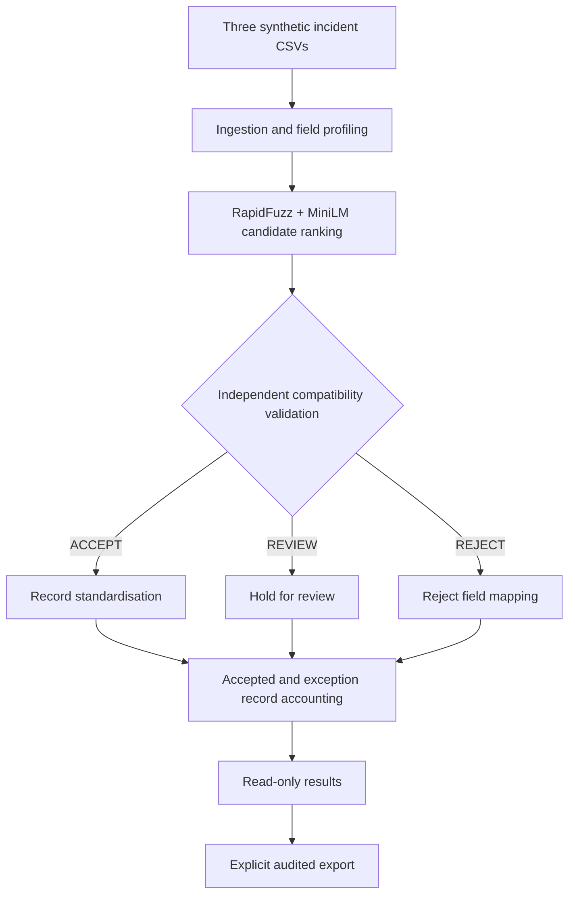

# SchemaBridge

**Explainable schema matching and auditable data reconciliation**

SchemaBridge is a Python and Streamlit application for reconciling incident data exported from systems with different field names, formats and business conventions. It combines lexical and semantic matching to suggest equivalent columns, applies independent compatibility rules, and produces standardised records with an audit trail of every exception.

The current application works with three supplied synthetic IT service-management datasets. Its focus is safe schema reconciliation: a similar column name or embedding score is never enough to approve a mapping.

**Stack:** Python 3.12 · Streamlit · pandas · RapidFuzz · Sentence Transformers (MiniLM) · NumPy · pytest

## Application

| Data Sources | AI Mapping |
|---|---|
|  |  |
| Validation | Results & Export |
|  |  |

The four-page workbench follows the data from its original structure to validated mappings and reconciled output:

1. **Data Sources:** Inspect the three source files, field definitions, data types and profiles without changing the input.
2. **AI Mapping:** Run RapidFuzz lexical matching and local MiniLM semantic ranking. Compare candidate mappings and their similarity scores.
3. **Validation:** Review `ACCEPT`, `REVIEW` and `REJECT` decisions based on field meaning, type, units, category rules, ambiguity and conflicting targets.
4. **Results & Export:** Inspect standardised records, held records and quarantined rows. Generate audit files through a separate, explicit export action.

## What it handles

- **Inconsistent schemas:** Ranks candidate matches between source columns and a canonical incident schema.
- **Business-rule validation:** Uses declared entity types and meanings, category dictionaries, compatible units and collision checks before a mapping can be accepted.
- **Value standardisation:** Normalises approved incident statuses and regions, and converts declared durations to minutes.
- **Conservative exception handling:** Holds ambiguous records for review and quarantines invalid data rather than guessing or silently dropping rows.
- **Traceability:** Preserves identifiers as text, including leading zeroes, and records `source_system` and `source_record_id` for each standardised record.
- **Controlled exports:** Writes four audit files to a unique output directory, verifies the output contents and checks SHA-256 hashes before serving downloads.

The application appends compatible records from each source; it does **not** attempt to join incident identities across systems.

## Processing pipeline



Four canonical business fields are supported: `incident_id`, `region`, `incident_status` and `resolution_minutes`. The two source-provenance fields are generated during processing rather than matched by the model.

The system separates candidate ranking, deterministic compatibility checks, row reconciliation and presentation. For the implementation details, see [Architecture](docs/ARCHITECTURE.md).

## Results

A recorded run with the included synthetic incident datasets produced:

| Measure | Result |
|---|---:|
| Input files | 3 |
| Input records | 180 |
| Declared source columns | 22 |
| Standardised records | **110** |
| Held for review | 59 |
| Quarantined | 11 |
| Distinct exception records | 70 |
| Recorded exception reasons | 74 |

Of the 110 standardised records, 35 included an accepted resolution duration and 75 had an allowed optional null duration. All 180 input records were accounted for.

A separate labelled synthetic challenge assessed schema-matching behaviour. RapidFuzz ranked the correct field first in 4 of 9 equivalent cases; MiniLM did so in 6 of 9. The conservative validator automatically accepted 3 of the 9 equivalents, and all three accepted mappings were correct in that small challenge. This shows the trade-off between automatic coverage and strict validation. It is not a measurement of performance on real operational data.

The detailed evaluation method and test evidence are in [Testing and evaluation](docs/TESTING.md).

## Run locally

The application was developed and exercised on Windows 11 with Python 3.12 and Streamlit 1.66.1. The steps below describe the intended local setup. A clean installation of this public repository on a separate machine has not been independently verified.

**1. Clone the repository and create a virtual environment**

```powershell
git clone https://github.com/Sonkhe-Shongwe/SchemaBridge.git
cd SchemaBridge
py -3.12 -m venv .venv
.\.venv\Scripts\Activate.ps1
```

**2. Install the Python dependencies**

```powershell
python -m pip install -r requirements-semantic.txt -r requirements-ui.txt
```

**3. Cache the embedding model once while online**

```powershell
python -c "from sentence_transformers import SentenceTransformer; SentenceTransformer('sentence-transformers/all-MiniLM-L6-v2', device='cpu')"
```

SchemaBridge loads the cached model on the local CPU when matching is requested. The ranking step expects that model to be available locally; it does not silently switch to a hosted inference service.

**4. Start the application**

```powershell
python -m streamlit run gui/streamlit_app.py
```

Open **http://127.0.0.1:8501**. From the interface, run the stages in order: **Run matching (offline)**, **Explain validation decisions**, then **Run reconciliation (read-only)**.

The final **Prepare audited reports (write once)** action is optional. It creates new files under the Git-ignored `output/gui_runs/` directory. You can inspect the complete workflow without writing reports.

## Outputs

When an audited export is prepared, SchemaBridge generates:

| File | Contents |
|---|---|
| `standardised.csv` | Records that passed the mapping and row-level checks |
| `rejected_rows.csv` | Held and quarantined records, with reason codes |
| `mapping_report.json` | Source-level mappings, decisions, row counts and provenance |
| `evaluation.json` | An explicitly unscored evaluation placeholder |

The separate synthetic challenge results are documented in [Testing and evaluation](docs/TESTING.md); they are not inserted into the runtime `evaluation.json`.

## Repository layout

```text
SchemaBridge/
├── src/schemabridge/     Matching, validation, ingestion and reconciliation
├── gui/                  Streamlit application, pages and session/export handling
├── config/               Canonical schema, source metadata and value rules
├── data/synthetic/       Three generated fictional incident exports
├── tests/                Core regression tests
├── gui/tests/            Interface and adapter regression tests
├── assets/screenshots/   Application screenshots
├── design/brand/         Logo and wordmark assets
└── docs/                 Architecture and testing documentation
```

## Tests

The repository includes core and Streamlit regression tests covering candidate ranking, compatibility decisions, record accounting, output checks and interface state. To run the included tests from the repository root:

```powershell
python -m pytest tests gui/tests -q
```

In the original Windows development checkout, the broader test suite recorded 128 passing core tests and 179 passing GUI tests. The redesigned interface also passed 22 focused GUI tests and was exercised in Chrome with the locally cached MiniLM model. Those historical results are distinct from a fresh test run of this public checkout, which contains a selected set of tests.

See [Testing and evaluation](docs/TESTING.md) for coverage, observed results and outstanding verification work.

## Scope

SchemaBridge currently uses a fixed canonical schema and the three included fictional CSVs. Adding arbitrary source uploads would require extending the metadata contract, validation rules and associated tests. The published setup also depends on a separately cached MiniLM model; it does not include a bundled model or a fully pinned transitive dependency environment.

The principal design decision is deliberate: **matching identifies possibilities; validated business rules determine what can be standardised.**
